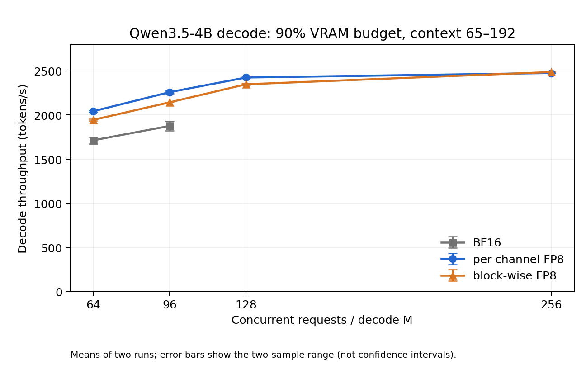

# 大 batch decode 吞吐

RTX 4070 Ti SUPER 16 GiB；TP=1，decode CUDA Graph、原生LM head/采样/调度、async output、queue=2。
每配置两次正式测量，均值；波动>5%标记*，不补第三次。模型加载、调优、capture、prefill、预热、收尾均不计入decode时间。
每请求一个相同起始token，63步不计时decode建立真实KV/GDN状态；计时128步，实际context_lens=65→192，最后独立收尾一步。
KV固定每请求一个256-token block，关闭prefix cache。仅捕获当前batch；显存边界按16个请求细化，假定容量随batch单调。

WSL2环境：三组统一限制PyTorch allocator为总显存的90%，预留驱动/桌面空间以避免系统内存回退。最大batch指该预算内的16对齐边界。

| batch | BF16 tok/s | per-channel tok/s | block-wise tok/s | PC相对BF16 | BW相对BF16 |
|---:|---:|---:|---:|---:|---:|
| 64 | 1714.2 | 2043.4 | 1945.6 | +19.20% | +13.50% |
| 96 | 1877.0* | 2259.8 | 2144.4 | +20.39% | +14.24% |
| 128 | — | 2425.5 | 2348.8 | — | — |
| 256 | — | 2476.4 | 2487.5 | — | — |

| 方案 | 最大可运行batch | 吞吐最高的已测batch | 已测峰值tok/s | 相对BF16已测峰值 |
|---|---:|---:|---:|---:|
| bf16 | 96 | 96 | 1877.0 | +0.00% |
| per_channel | 256 | 256 | 2476.4 | +31.93% |
| block_wise | 256 | 256 | 2487.5 | +32.52% |

峰值只针对本次已测batch及短上下文；跨batch收益包含容量收益。不同量化产生的token轨迹可能不同，但context长度、总token数、起始输入完全一致。
每请求GDN BF16 recurrent+conv状态约25.125 MiB，BF16 KV约8 MiB，两者共约33.125 MiB；权重量化不缩小这些缓存。
容量是仅捕获当前batch、固定KV分配下的边界；部署默认捕获全部较小batch会增加显存占用。
原始样本、OOM边界日志、调优缓存、源码/模型指纹：`/home/wei/code/nano_qwen/logs/fp8-decode-capacity-2026-10-14/data`。

## 吞吐曲线和记录

共10个正式配置、20个样本；实际M、128次decode Graph、窗口中0次prefill以及autotune稳定性全部核对通过。BF16 batch96两次吞吐差异为5.62%，没有追加第三次。

BF16 batch128的首次未限额预热在WSL显存几乎耗尽时明显变慢，正式计时前停止；是否发生驱动系统内存回退未直接profiling验证。随后统一90% allocator预算。已完成BF16 batch64的峰值reserved=12610MiB低于预算，两个原始样本SHA保持一致；旧源码/身份及适配理由见provenance.json。

原始JSON中的weight_mib为逐Parameter逻辑求和，embedding/head虽为不同Parameter但共享存储，重复计入约1.18GiB；扣除共享引用后，BF16约7.83GiB、per-channel约4.52GiB、block-wise约4.51GiB。容量还包括当前捕获路径的驻留buffer和采样临时内存，正式峰值采用PyTorch实际allocated/reserved统计。

全套测试114项通过。生产源码未改动；源代码身份、相邻OOM边界和旧样本原值已核对。
