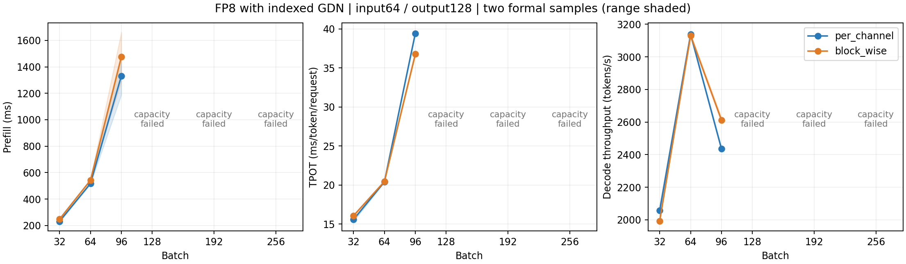
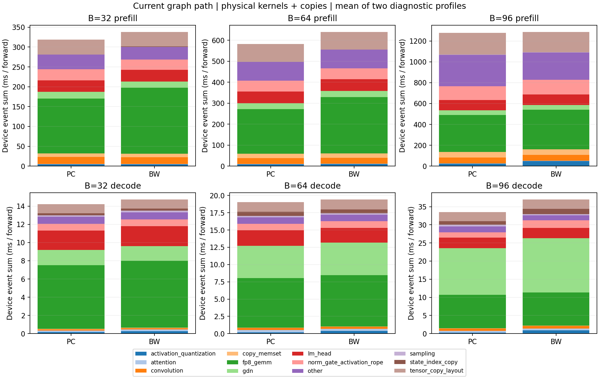

# FP8 graph矩阵与阶段分解（GDN原地更新后，2026-10-15）

两种FP8，batch=32/64/96/128/192/256，输入64、输出128，每配置计划两次正式计时，prefill/decode均使用graph。B96为本轮增补，沿用相同源码快照与参数；其余batch保留原测量，没有重复运行。旧版B1–64结果已[归档](../fp8_phase_profile_before_gdn_pool_20261015/results.md)。

当前生产源码包含GDN recurrent-state按slot原地更新。RTX4070TiSUPER16GiB/WSL2，TP=1，queue depth2、异步输出、关闭prefix cache、ignore EOS；固定KV为每slot两个256-token block，allocator显存预算90%。prefill一次处理整个batch，精确bucket的M=batch×64；decode M=batch，首token来自prefill，完整decode127步（context65…191）。保持这一路径，容量失败按实记录。

## 正式计时（profiler关闭）

| B | PC完成/计划 | BW完成/计划 | PC prefill ms | BW prefill ms | PC TPOT ms | BW TPOT ms | PC token/s | BW token/s |
|---:|---|---|---:|---:|---:|---:|---:|---:|
| 32 | 2/2 | 2/2 | 231.34 | 248.56 | 15.56 | 16.05 | 2057.13 | 1993.38 |
| 64 | 2/2 | 2/2 | 517.42 | 542.13 | 20.39 | 20.44 | 3138.47 | 3130.85 |
| 96 | 2/2 | 2/2 | 1331.66 | 1476.05 | 39.42 | 36.76 | 2435.35 | 2611.70 |
| 128 | 0/2 capacity | 0/2 capacity | — | — | — | — | — | — |
| 192 | 0/2 capacity | 0/2 capacity | — | — | — | — | — | — |
| 256 | 0/2 capacity | 0/2 capacity | — | — | — | — | — | — |

表中为完成两次配置的算术均值。[原始计时](timing_samples.csv)、[均值/状态](timing_means.csv)、[完整JSON](results.json)。TPOT=decode_ms/127，不再除batch；吞吐=batch×127/decode秒。没有补测第三次。失败配置不生成虚假耗时或吞吐。

B96存在设备显存读数达到总容量的正式样本；allocated/reserved/device_used原值保留在JSON。其吞吐变化需结合显存压力解读，本轮没有测量分页或实际DRAM流量。

## 容量结果

下列配置在当前完整prefill与90%显存预算下未完成两次计时，属于本测试的容量边界，不等于相同batch的decode单独不可运行。每个配置保留一次初始化/执行尝试、真实完成样本数与错误日志；容量失败没有再次重复相同分配。

| 方案 | B | 原因 | 完成/计划 | 失败阶段 |
|---|---:|---|---|---|
| per_channel | 128 | KV budget guard | 0/2 | KV allocation |
| block_wise | 128 | KV budget guard | 0/2 | KV allocation |
| block_wise | 192 | CUDA OOM | 0/2 | engine initialization warmup / LM head |
| per_channel | 192 | CUDA OOM | 0/2 | engine initialization warmup / LM head |
| per_channel | 256 | CUDA OOM | 0/2 | engine initialization warmup / GDN chunk state |
| block_wise | 256 | CUDA OOM | 0/2 | engine initialization warmup / GDN chunk state |

错误详情和本机日志路径见 [failure_cases.csv](failure_cases.csv) 及 JSON。完整prefill的logits形状是`(batch×64,248320)`，BF16 logits本身在B128/192/256约需3.79/5.68/7.58GiB，此外还有FP8权重、GDN状态、KV和graph临时量。这个测试不能与先前decode-only容量结果混用。

## Graph阶段分解

对两方案都完成的batch另采两次graph profile，每次包含完整prefill及最初8步decode（context65…72），其余119步在profiler外收尾。仅用于归因，不替代完整127步的正式耗时。累加实际kernel/memcpy/memset并排除GPU annotation；LM head通过CUDA launch correlation归因。

| B | 阶段 | 方案 | GPU累计ms/forward两次 | GPU内部空隙ms/forward两次 | FP8 GEMM占比两次 | GDN核心占比两次 |
|---:|---|---|---:|---:|---:|---:|
| 32 | prefill | per_channel | 228.77 / 408.63 | 12.87 / 9.97 | 37.94 / 46.25 | 5.65 / 5.19 |
| 32 | prefill | block_wise | 244.70 / 431.62 | 13.04 / 10.87 | 42.34 / 53.22 | 5.31 / 4.22 |
| 32 | decode | per_channel | 14.21 / 14.24 | 1.79 / 2.01 | 49.45 / 49.22 | 11.38 / 12.08 |
| 32 | decode | block_wise | 14.67 / 14.81 | 2.14 / 2.45 | 49.69 / 50.27 | 11.16 / 10.61 |
| 64 | prefill | per_channel | 497.38 / 665.25 | 13.68 / 15.64 | 34.00 / 38.74 | 4.94 / 4.73 |
| 64 | prefill | block_wise | 533.00 / 746.05 | 15.04 / 19.22 | 38.17 / 44.54 | 4.74 / 4.38 |
| 64 | decode | per_channel | 18.98 / 19.06 | 2.43 / 2.58 | 37.66 / 37.90 | 24.53 / 24.40 |
| 64 | decode | block_wise | 19.45 / 19.41 | 2.19 / 2.88 | 38.31 / 37.90 | 24.28 / 24.33 |
| 96 | prefill | per_channel | 1169.62 / 1389.64 | 24.28 / 29.36 | 29.85 / 25.98 | 3.84 / 3.34 |
| 96 | prefill | block_wise | 1180.45 / 1394.34 | 19.14 / 26.34 | 32.47 / 27.17 | 3.85 / 3.24 |
| 96 | decode | per_channel | 32.99 / 34.07 | 2.82 / 3.61 | 26.97 / 28.05 | 38.71 / 38.33 |
| 96 | decode | block_wise | 38.00 / 35.99 | 2.86 / 3.50 | 23.64 / 26.13 | 40.72 / 40.20 |

阶段原值见 [phase_samples.csv](phase_samples.csv)。profile绝对时间受采集开销与波动影响，速度比较使用上面的关闭profiler计时。GPU内部空隙是本进程trace的设备事件间隙，不直接等同CPU时间；GPU busy另按interval union记录，跨stream累计时间可能重叠。本轮全程graph，没有沿用旧B8 eager投影归因。

## 来源与复现

- 完成正式样本12次，诊断profile 12次；请求的12个配置全部保留状态。
- 生产源码SHA256：`213bbb01fa2040643fe6fdd685222a94d3159b3027061604008ac0cd5adb8ede`；入口SHA256：`1a1cdbb74158974820a709fa3763b8f15f74e3a7099e69fa059e11c69530fb6a`。
- 原始数据、不可变源码快照与调度脚本：`logs/fp8-large-batch-2026-10-15/`。两模型分别为`/home/wei/code/models/4b-channel-fp8`、`/home/wei/code/models/4b_block_fp8`。
- 复用`bench_one_batch.py --batch-size B --input-len 64 --decode-steps 127 --max-model-len 256 --timing-rounds 2 --profile-rounds 0 --workload-memory`；阶段诊断改为`--timing-rounds 0 --profile-rounds 2 --profile-decode-steps 8`。
- 本轮只执行测试和覆盖数据报告，不修改生产算子；模型质量与实际DRAM流量不在本轮测量范围。
