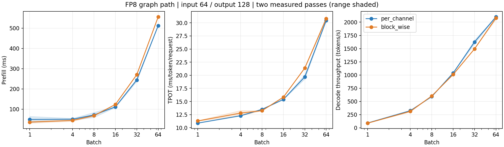
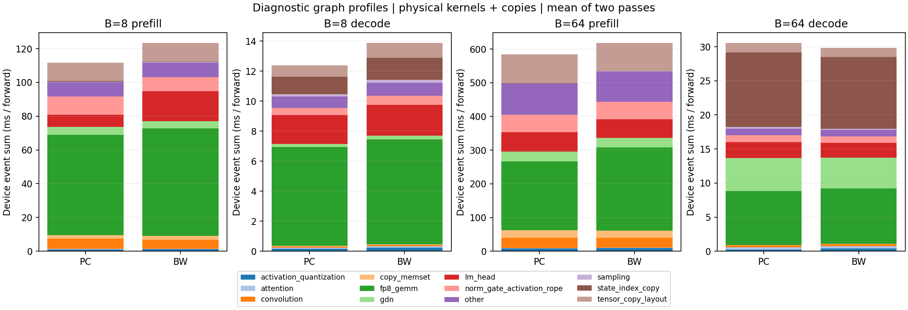

# FP8 prefill/decode 分解与 batch 曲线（2026-10-15）

本轮优先热点：**大 batch decode 的 GDN recurrent-state gather/scatter**。B=64 时这两次状态复制合计占 GPU累计时间约33%–34%，超过所有 FP8 GEMM 合计的约26%–27%。小 batch decode 和 prefill 则仍以 FP8 GEMM 为首要 kernel 时间项。

RTX 4070 Ti SUPER 16 GiB / WSL2，当前 `eb3ba3e` 生产源码。两种 FP8，各 batch 独立进程；固定输入64、输出128，每配置预热一次、正式计时**两次**。prefill 与 decode 都启用 CUDA Graph，queue depth=2、异步输出、关闭 prefix cache、忽略 EOS。

`M` 是本次 Linear 的 token 行数：prefill 为 `batch × 64`，decode 为 `batch`。首个输出来自 prefill，所以完整 decode 是127步，context=65…191。TPOT=`decode_ms/127`，吞吐=`batch×127/decode_seconds`。

## 关闭 profiler 的正式计时

表中为两次算术平均；[两次原始值](timing_samples.csv)与[均值](timing_means.csv)分别保留，未因波动追加第三次。阴影为两次最小/最大范围。

| Batch | PC prefill ms | BW prefill ms | PC TPOT ms | BW TPOT ms | PC token/s | BW token/s |
|---:|---:|---:|---:|---:|---:|---:|
| 1 | 49.48 | 36.34 | 10.883 | 11.299 | 91.9 | 88.5 |
| 4 | 50.80 | 44.50 | 12.284 | 12.791 | 325.6 | 313.2 |
| 8 | 71.65 | 68.19 | 13.503 | 13.251 | 592.5 | 603.7 |
| 16 | 111.40 | 123.50 | 15.409 | 15.837 | 1038.4 | 1010.3 |
| 32 | 244.28 | 270.68 | 19.702 | 21.393 | 1624.9 | 1495.8 |
| 64 | 512.56 | 555.98 | 30.443 | 30.795 | 2102.3 | 2078.6 |



B=64 的 per-channel / block-wise 吞吐约为 **2102 / 2079 token/s**。本次较大 M 的 prefill（B=16/32/64）per-channel 更快；decode 胜负随 batch 变化，B=64 差距约1.1%，两次样本不足以认定稳定胜负。

本轮曲线到 B=64 仍在上升，不能称为吞吐极限。B=64 正式计时的分配峰值约10 GiB；考虑模型固定权重与随 batch 增长的状态、prefill 中间量，本轮未扩展到 B=128。每个进程限制 CUDA allocator 为显存的90%，KV 固定为每 slot 两个256-token block，仅捕获精确 prefill bucket；所有正式样本均确认一轮 prefill、127轮精确 batch decode graph，没有 eager 回退、抢占、allocator retry 或 OOM。

## Graph 路径的 GPU 分解

B=8/64、两方案各 profile 两次。每次记录完整 prefill 和最初8步 decode（context=65…72），其余119步在 profiler 外执行以正常收尾。下表 decode 均除以8，单位为每次 forward。**这不是完整127步的平均分解**，也不替代上面的关闭 profiler 计时。

只累计实际 GPU kernel、memcpy、memset；排除 GPU user annotation，避免重复计算。LM head 用 CUDA launch correlation 对应其 CPU scope，其他 kernel 按名称归类。GDN索引包含状态 gather/scatter（少量同类索引也在该项）；采样、张量布局拷贝、其他逐元素算子保留独立分类，明细见 [phase_samples.csv](phase_samples.csv)。

| B | 阶段 | 方案 | GPU累计 ms 两次 | FP8 GEMM % 两次 | LM head % 两次 | GDN核+索引 % 两次 | GPU内部空隙 ms 两次 |
|---:|---|---|---:|---:|---:|---:|---:|
| 8 | prefill | per-channel | 50.72 / 172.55 | 46.83 / 55.13 | 13.70 / 4.30 | 4.05 / 4.57 | 13.14 / 8.16 |
| 8 | prefill | block-wise | 53.38 / 193.25 | 48.15 / 52.46 | 12.94 / 14.96 | 3.86 / 3.67 | 18.46 / 6.71 |
| 8 | decode | per-channel | 12.31 / 12.49 | 53.42 / 52.85 | 15.67 / 15.25 | 10.73 / 11.41 | 1.58 / 2.36 |
| 8 | decode | block-wise | 12.37 / 15.39 | 53.75 / 47.77 | 16.07 / 13.55 | 10.38 / 14.28 | 1.81 / 2.47 |
| 64 | prefill | per-channel | 485.85 / 683.76 | 33.32 / 36.06 | 11.43 / 8.87 | 5.16 / 5.15 | 13.55 / 13.89 |
| 64 | prefill | block-wise | 528.71 / 706.98 | 38.78 / 40.97 | 10.54 / 7.87 | 4.84 / 4.55 | 14.47 / 15.54 |
| 64 | decode | per-channel | 29.22 / 31.87 | 26.02 / 25.88 | 7.77 / 7.36 | 51.66 / 51.68 | 2.41 / 2.79 |
| 64 | decode | block-wise | 29.84 / 29.86 | 27.41 / 27.00 | 7.12 / 7.21 | 50.16 / 50.78 | 2.32 / 3.02 |



图为两次 GPU累计时间的均值；prefill profile 两次波动明显，尤其 B=8，不能用这些绝对时间直接比较两方案速度。B=8 decode 与两档 prefill 中，FP8 GEMM 占比最高；B=64 decode 则是状态索引复制最高。GPU累计时间可能跨 stream 重叠，另存 interval union 作为 GPU busy 时间；“内部空隙”是第一到最后一个设备事件之间本进程 trace 中没有设备事件的时间，**不能直接称为 CPU 执行时间**，也不一定全部可消除。CPU scope 及同步等待仍可在原始 trace 中检查。

## 大 batch decode 的首要热点

B=64 trace 中，同名 gather kernel 按 grid 分成 embedding、conv-state、recurrent-state；recurrent gather 的 grid 为 `[64,256,1]`，recurrent scatter 为 `[65536,1,1]`，每个窗口各192次，正好是24层GDN×8步。因此可以单独排除 embedding 和conv-state，只统计 recurrent state。

| 方案 | 轮次 | recurrent gather ms/步 | recurrent scatter ms/步 | 合计 ms/步 | 占GPU累计时间 % |
|---|---:|---:|---:|---:|---:|
| block-wise | 1 | 4.294 | 5.601 | 9.895 | 33.17 |
| block-wise | 2 | 4.277 | 5.641 | 9.918 | 33.22 |
| per-channel | 1 | 4.402 | 5.454 | 9.856 | 33.73 |
| per-channel | 2 | 4.720 | 6.057 | 10.777 | 33.82 |

位置是 [`GatedDeltaNet._read_state / _write_state`](../../../src/nano_qwen/layers/gated_delta_net.py)：先 `recurrent_states.index_select(0, idx)` 取出状态，decode核心更新后，再 `index_copy_` 写回池。GDN recurrent-state 加核心计算共约50%的GPU累计时间；这一共享成本也解释了大batch下两种FP8吞吐接近。

仅 recurrent state 就是每请求每层 `32×128×128×2 B = 1 MiB`，24层、B=64共1536 MiB。gather的读+写与scatter的读+写合计 `4×1536 MiB = 6 GiB/步` 的额外逻辑读写，**尚未计核心更新本身和conv-state**。这是按tensor尺寸推导的流量，非硬件DRAM计数。

下一步只优先优化这一处：尝试让decode kernel按 `state_indices` 直接访问状态池，减少recurrent-state往返复制，保持请求slot隔离和BF16更新/舍入规则；先用B=64验证再回归小batch。此轮仅完成测试和定位，尚未实施该优化。

## FP8投影的补充归因

另采 B=8 eager trace，每方案两次，仅用来给具体投影归因。诊断标记直接包住 per-channel 的 `apply_quantized` 和 block-wise 的 `apply`，覆盖共享输入路径，避免 Linear.forward hook 漏掉 q/k/v、qkv/z。每次都核对 prefill 的168次、8步 decode 的1344次 FP8 GEMM 全部成功对应投影。下表是各投影占本阶段 **FP8 GEMM累计时间** 的比例，两次比例取均值，不是端到端占比；[原始投影计时](projection_samples.csv)。

| 投影 | 次数/forward | PC prefill % | BW prefill % | PC decode % | BW decode % |
|---|---:|---:|---:|---:|---:|
| gate_up_proj | 32 | 42.66 | 41.05 | 41.70 | 41.52 |
| down_proj | 32 | 20.96 | 21.49 | 23.46 | 24.05 |
| in_proj_qkv | 24 | 13.70 | 15.02 | 12.87 | 12.22 |
| in_proj_z | 24 | 7.38 | 6.99 | 6.98 | 6.82 |
| out_proj | 24 | 6.94 | 7.31 | 6.41 | 6.55 |
| q_proj | 8 | 4.87 | 3.93 | 4.41 | 4.16 |
| o_proj | 8 | 2.39 | 2.73 | 2.13 | 2.18 |
| k_proj | 8 | 0.55 | 0.51 | 1.02 | 1.25 |
| v_proj | 8 | 0.54 | 0.98 | 1.03 | 1.24 |

如果后续专门优化小batch或prefill，FP8范围内优先看 **`gate_up_proj`**：它占B=8的FP8 GEMM约42%，属于每层MLP，融合gate/up，`N=18432、K=2560`、32次/forward。它不是本轮大batch decode的首要热点；eager比例也不能直接代入B=64的graph结果。

## 数据与复现

- [results.json](results.json)：全部24次正式计时、12次诊断 profile、kernel 排名、来源 hash、模型/graph 配置与 GPU 遥测。
- 原始日志与 Perfetto trace：`logs/fp8-phase-profile-2026-10-15/`；测量前源码/诊断 wrapper 在 `source-snapshot.zip`。
- 生产源码 SHA256：`9704407501c9783bf24791284e23e53a99c94c012588dda8a3ab805ca8d2d6c1`；bench_one_batch SHA256：`194a1f033c0a442df79ee5303a43f3fb89f81f3a4dc38d639508491f140441dc`。
- 模型：`/home/wei/code/models/4b-channel-fp8` 与 `/home/wei/code/models/4b_block_fp8`，均核对168个对应 FP8 方法。测试环境 PyTorch 2.12.1+cu130、Triton 3.7.1、TP=1。此轮不评价模型质量。
- 自动回归：`python -m pytest -q`，94 passed（20条依赖库告警）；覆盖GPU去重、busy union/gap、未归属事件、大batch gather分类与CLI。
- 测量完成后仅修正kernel分类，把 `vectorized_gather_kernel` 并入状态索引；未重跑任何测量，也未修改原始计时/trace。修正后的分类器 SHA256：`1a1cdbb74158974820a709fa3763b8f15f74e3a7099e69fa059e11c69530fb6a`。JSON中的 `breakdown` 保留现场分类，`attribution` 是修正后的离线分类；归类前后设备事件总时间严格相等。

单个配置复现正式计时（修改模型和 batch 即可重复本矩阵）：

```bash
python benchmarks/bench_one_batch.py --model /home/wei/code/models/4b-channel-fp8 \
  --batch-size 8 --input-len 64 --decode-steps 127 --max-model-len 256 \
  --timing-rounds 2 --profile-rounds 0 --workload-memory --output-dir logs/fp8-timing
```

单独采 graph profile 时改为 `--timing-rounds 0 --profile-rounds 2 --profile-decode-steps 8`，写入新的 output-dir。投影标记使用测量归档中的 `profile_worker.py`，加 `--enforce-eager`；不能把 eager 的耗时作为 graph 的端到端结果。

只读复核未发现 Critical/Important 问题。留有一处 Minor：`--trace-stage all` 时，`--profile-skip-decode` 的跳过步骤仍会被 profiler 记录，只是不计入阶段窗口，CLI写成“Unprofiled”不准确；本轮跳过步数为0，不影响上述数据。
