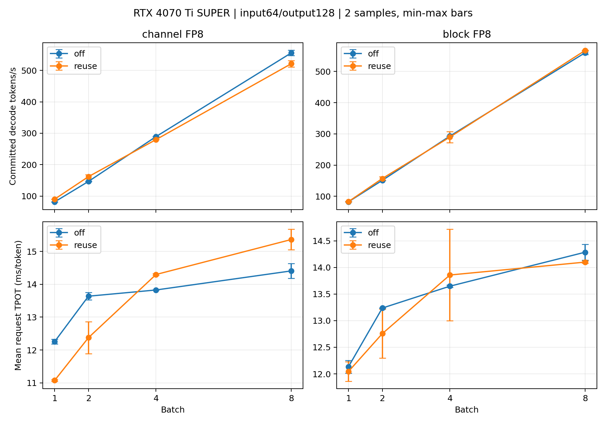

# Greedy fast path后：B1/2/4/8 MTP曲线（2026-10-15）

本轮per-channel在B1/B2平均提高10.7%/10.4%，B4/B8回退3.3%/6.2%；仅在这组工作负载中，收益由正转负发生在B2与B4两个测试点之间。block-wise平均为+0.8%/+3.9%/−1.1%/+1.3%，没有单调或稳定的分界，B4两次reuse分别307.73/271.79tok/s，跨过off约293tok/s。当前建议per-channel优先考虑B1/B2，B4/B8保留off；block-wise继续视为小幅、不确定收益。暂不扩B16，先用新B2/B4 trace检查开销和波动来源。

RTX4070TiSUPER16GB，Qwen3.5-4B，两种FP8，独立BF16 MTP权重，TP1，input64/output128，greedy。prefill eager/decode CUDA Graph，profiler关闭；所有点固定max_model_len1024、GPU预算0.85、max_batched_tokens1024，只改变max_num_seqs=B。每点同一resident engine交错off1/reuse1/off2/reuse2，各组合先做4-token不计时预热。off停止MTP执行但MTP权重/graph仍驻留；这是执行收益对照，不是卸载MTP的容量对照。

每样本统计B×127个实际提交decode tokens；TPOT为各请求(完成时间−首token时间)/127的均值，吞吐为总实际decode tokens/整批decode时间。TTFT与请求总耗时另存；不使用projected吞吐。32个正式样本完整completion严格一致；另有两种FP8×B4/B8×eager/Graph×off/serial/reuse的24个异长真实模型门禁，全部严格一致，门禁仅作正确性诊断不纳入性能均值。原始tokens、每轮实际提交数、每请求延迟、接受率、显存、执行顺序和源码SHA256见[JSON](results.json)，逐次数据见[CSV](samples.csv)。

| FP8 | B | off tok/s | reuse tok/s | 吞吐收益 | off TPOT ms | reuse TPOT ms | 接受率 |
|---|---:|---:|---:|---:|---:|---:|---:|
| channel | 1 | 81.60 | 90.30 | +10.7% | 12.256 | 11.074 | 89.6% |
| channel | 2 | 146.67 | 161.86 | +10.4% | 13.637 | 12.375 | 81.4% |
| channel | 4 | 289.30 | 279.77 | -3.3% | 13.826 | 14.297 | 84.1% |
| channel | 8 | 555.42 | 521.00 | -6.2% | 14.407 | 15.361 | 84.1% |
| block | 1 | 82.41 | 83.04 | +0.8% | 12.136 | 12.045 | 81.4% |
| block | 2 | 151.09 | 156.99 | +3.9% | 13.237 | 12.756 | 78.9% |
| block | 4 | 293.09 | 289.76 | -1.1% | 13.648 | 13.858 | 84.1% |
| block | 8 | 560.05 | 567.37 | +1.3% | 14.286 | 14.100 | 86.8% |

| FP8 | B | off / reuse TTFT ms | off / reuse请求总耗时 s |
|---|---:|---:|---:|
| channel | 1 | 84.69 / 127.54 | 1.641 / 1.534 |
| channel | 2 | 69.36 / 102.11 | 1.801 / 1.674 |
| channel | 4 | 119.11 / 153.02 | 1.875 / 1.969 |
| channel | 8 | 99.58 / 119.68 | 1.929 / 2.071 |
| block | 1 | 106.09 / 106.27 | 1.647 / 1.636 |
| block | 2 | 63.39 / 117.72 | 1.744 / 1.738 |
| block | 4 | 78.04 / 93.97 | 1.811 / 1.854 |
| block | 8 | 89.15 / 103.58 | 1.903 / 1.894 |

MTP的TTFT成本会抵消一部分decode收益，例如block-wise B2虽然decode平均+3.9%，请求总耗时仅1.744→1.738s。TTFT两次也有波动，这里未优化prefill。greedy控制实验与本曲线各自重新建立engine/调优，B2收益数值不能直接相减归因；受控greedy结论仍以[同engine配对报告](../mtp_greedy_fast_path/results.md)为准。

[SVG](batch_tpot_throughput.svg)用于独立导出。误差棒仅是两次样本min/max，不是置信区间；相近结果不能据此判定稳定领先。跨batch不要求completion一致，各batch内部以自己的ordinary M=B为参考。

生命周期回归覆盖两种FP8、eager/Graph、接受子集大小0..B及非连续mask、B8→1所有活跃大小、EOS、不同结束时间、新请求/slot复用；对齐相同已消费前缀逐位比较hidden、真实logits、GDN状态、target KV和MTP KV。所有subset大小1..8的full/cache-only KV也逐位相同。B4子集>4的参数标记skip，其对应B8测试实际执行。

新生产路径支持FP8、TP1、greedy、capacity1..8；verify/draft/cache-only每个实际大小独立Graph，普通decode容量≤8也捕获全部大小，避免B3/5/6/7使用padding后的参考。M=2B沿用当前GPU/shape的M=B调优选择，未修改全局autotuner缓存。BF16仍限B1 serial，B16保持guard，5090未测。B2/B4新trace尚未采集，不将旧B1热点比例用于多请求优化决策。

复现：`python benchmarks/bench_mtp_interleaved.py --model FP8_DIR --mtp-model BF16_DIR --batches 1 2 4 8 --cases same64 --samplers fast --output logs/curve.json`；异长真实模型门禁使用`bench_mtp_batch_gates.py`。软件版本、设备和配置均在JSON的environment/config中，模型使用路径及源码文件SHA256保留。

最终验证：完整pytest 619 passed、32 skipped（B4不可行子集参数），修改范围Ruff与git diff --check通过；独立审查确认逐次数据、均值、计数、执行顺序、源码指纹与图一致，没有剩余重要问题。
