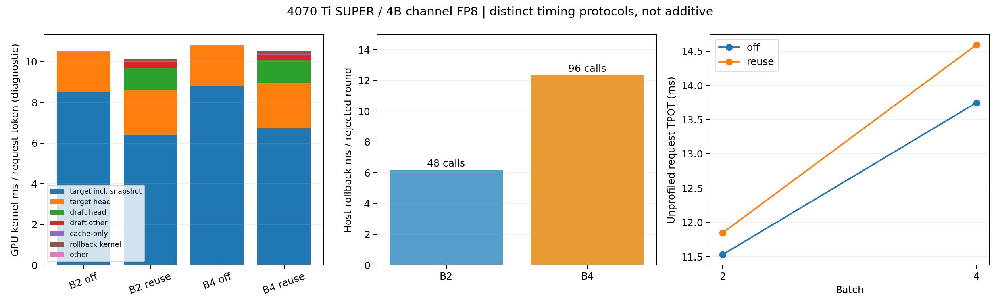

# B2/B4 MTP阶段成本：高接受率没有消除逐请求回滚开销（2026-10-18）

本轮选择的下一项优化是**拒绝路径按slot批量rollback**，本提交只补profiling。B4每个拒绝轮需要4请求×24层=96次Python回滚调用，host约12.36ms；B2是48次、约6.20ms。摊到每请求输出token，CPU回滚scope由0.63升到0.97ms。决策table等待远小于它，因此不先做整套GPU接受判定；LM head仍是主要额外GPU成本，但本轮GPU kernel总量已减少，最终余量很容易被逐请求回滚提交抵消。

必须限定结论：**新正式计时没有稳定复现旧图的“B2正收益”**。同样4070TiSUPER/4B/per-channel/input64/output128下，本轮B2均值为负，且两次一正一负；B4两次均为负。旧图B2 +10.4%、B4 −3.3%保留历史身份。本报告解释高接受率下的成本组成和B4放大的串行开销，不能反向证明旧运行的唯一原因；旧图没有保存全部调优配置。main的独立greedy移植另见[main报告](https://github.com/Jung52/nano_qwen/blob/e936f58/benchmarks/reports/greedy_main/results.md)，不混用两条runner路径的收益。

## 1. 协议与正确性

- TP1、greedy、独立BF16 MTP权重，prefill eager/decode Graph，enable_mtp默认仍关闭；off控制保留同engine的MTP权重/Graph，只暂停执行。
- 首先关闭profiler和所有插桩，按off1/reuse1/off2/reuse2正式计时，每配置**仅2次**，每样本计B×127个实际提交decode tokens。
- CUDA event阶段pass：完整128输出，分别记录target body/head、draft body/head、cache-only、snapshot、rollback。只读本轮实际replay的精确bank；每step同步/读取event，因此此pass的host空隙不代表生产。
- 时间线pass：先恢复原始Graph，去除external event节点，再用PyTorch CPU+CUDA profiler截取completion约48→80的窗口。GPU物理kernel只算一次，嵌套annotation不加到kernel总量。draft图内head仅在draft scope内匹配同trace target head的name/grid/block指纹。
- 动态尾段另用预算128/124（B2）及128/124/120/116（B4），记录实际活跃数、stable slot、已消费位置及提交数；B4→3→2→1、B2→1均实际出现。每轮记录accept/reject和实际提交token，不用projected吞吐。
- 为检查profiler扰动，另一次独立进程只用perf_counter_ns记录host scope，**无profiler、CUDA计时节点或额外GPU同步**。这是诊断，不是新增第三次正式样本。

8个正式样本、4个event完整cohort、8个短trace/动态尾段、4个host完整cohort均通过off/reuse严格completion门禁。动态off作为该动态工作负载自己的参考，不与固定B的不同算术shape混比。真实4B覆盖per-channel Graph；两种FP8/eager/Graph的小模型在插桩下继续通过serial/reuse逐前缀hidden、真实logits、GDN和target/MTP KV门禁。

## 2. 新正式计时（与诊断分开）

| B | off tok/s（两次范围） | reuse tok/s（两次范围） | reuse平均收益 | off / reuse TPOT ms | drafted接受率 |
|---|---:|---:|---:|---:|---:|
| 2 | 173.48（171.15–175.81） | 168.94（164.15–173.73） | -2.6% | 11.531 / 11.848 | 81.4% |
| 4 | 290.99（287.56–294.43） | 274.23（268.38–280.08） | -5.8% | 13.748 / 14.593 | 84.1% |

B2完整decode是70轮、提交254token；B4是69轮、提交508token（含最终普通尾步）。接受率是accepted/drafted；仅在真正verify的请求中，B4为232/(232+40)=85.3%，而accepted/drafted为84.1%，分母不同。即使接近84%，需要继续生成的verify轮仍须执行两个target head和一个draft head；这些成本不能按target主干相同的权重复用比例估计。

## 3. CUDA event阶段分解

单位是**ms/实际提交的batch聚合decode token**；同B比较，乘B才得到每请求token对应的量。这里是GPU event包围的区间，包含kernel间enqueue空隙，尤其是rollback，不能当纯kernel时间。

| B | 路径 | target body（扣snapshot） | target head | draft body | draft head | cache-only body | snapshot | rollback区间 |
|---|---|---:|---:|---:|---:|---:|---:|---:|
| 2 | off | 4.8962 | 1.1180 | 0.0000 | 0.0000 | 0.0000 | 0.0000 | 0.0000 |
| 2 | reuse | 3.7937 | 1.3532 | 0.1824 | 0.6242 | 0.0315 | 0.1154 | 0.3469 |
| 4 | off | 2.5184 | 0.5362 | 0.0000 | 0.0000 | 0.0000 | 0.0000 | 0.0000 |
| 4 | reuse | 1.7117 | 0.5817 | 0.0790 | 0.2883 | 0.0179 | 0.0797 | 0.1601 |

归属规则：原始target包含body和head，target_body又包含snapshot；表中先减snapshot再单列。draft外层包含body/head及输入准备，cache_only外层包含cache_body及输入准备；表用body，外层原值留JSON/CSV，不能再与body相加。rollback event区间与host提交交错，后文单列其实际物理kernel及host开销。

## 4. 无event节点的短时间线：GPU kernel与空隙

同样单位ms/实际提交聚合token。窗口token数精确使用记录值，off/reuse取相同大致已消费区间，不把每轮verify强行当成一个token。target列在Graph中包含snapshot；不能再添加上一张表的snapshot。

| B | 路径 | 窗口提交数 | target含snapshot | target head | draft head | draft其他 | cache-only | rollback kernel | GPU kernel合计 | GPU活动区间空隙 |
|---|---|---:|---:|---:|---:|---:|---:|---:|---:|---:|
| 2 | off | 64 | 4.2700 | 0.9718 | 0.0000 | 0.0000 | 0.0000 | 0.0000 | 5.2637 | 0.9353 |
| 2 | reuse | 64 | 3.2057 | 1.1019 | 0.5451 | 0.1406 | 0.0270 | 0.0307 | 5.0566 | 1.5007 |
| 4 | off | 128 | 2.1995 | 0.4923 | 0.0000 | 0.0000 | 0.0000 | 0.0000 | 2.7030 | 0.5126 |
| 4 | reuse | 128 | 1.6860 | 0.5553 | 0.2774 | 0.0700 | 0.0135 | 0.0309 | 2.6363 | 1.5857 |

GPU busy是所有物理kernel/memcpy/memset区间的并集，gap只计算首末device事件之间未被覆盖的区间。kernel合计可能与并集不同；annotation不算物理工作。B4 target kernel减少约0.514ms/聚合token，但额外head约0.340ms、draft/cache/rollback进一步消耗余量，最后GPU kernel总量仅减少约0.06ms/聚合token。高接受率不意味着有宽裕的端到端收益空间。

CPU+CUDA profiler下的gap明显受插桩影响，不能把它乘吞吐预测提速，也不能把decision_wait整段当作可消除时间：它可能覆盖GPU工作。原始JSON分别记录wait、与GPU busy交集及无已记录GPU活动的部分。轻量host pass给出另一种、扰动更小的等待观察。

| B | 路径 | CPU decision wait ms/聚合token | 与GPU busy重叠 | 无已记录GPU活动部分 |
|---|---|---:|---:|---:|
| 2 | off | 0.00000 | 0.00000 | 0.00000 |
| 2 | reuse | 0.02846 | 0.00038 | 0.02808 |
| 4 | off | 0.00000 | 0.00000 | 0.00000 |
| 4 | reuse | 0.01666 | 0.00303 | 0.01363 |

上表是profiler时间线中的交集观测，不等同于生产可消除成本；尤其不能把CPU wait与其覆盖的GPU工作相加。

## 5. 轻量host pass：拒绝路径为何随B放大

本表来自独立诊断进程，每配置一次完整cohort，不加入正式性能均值。CPU scope可以含GPU等待；与GPU时间重叠的部分不可重复相加。每请求token单位由聚合scope/实际提交tokens×B得到。

| B | 路径 | 诊断TPOT ms | decision table等待 ms/请求token | rollback ms/请求token | 拒绝轮数 | rollback调用数 | 每拒绝轮rollback ms |
|---|---|---:|---:|---:|---:|---:|---:|
| 2 | off | 11.427 | 0.0000 | 0.0000 | 0 | 0 | 0.000 |
| 2 | reuse | 11.906 | 0.0908 | 0.6342 | 13 | 624 | 6.196 |
| 4 | off | 11.562 | 0.0000 | 0.0000 | 0 | 0 | 0.000 |
| 4 | reuse | 12.396 | 0.0768 | 0.9731 | 10 | 960 | 12.359 |

同一个host pass内，B2/B4的off→reuse诊断TPOT差分别约0.48/0.83ms，差值约0.36ms；rollback scope随B增加约0.34ms/请求token，与这部分增长接近。每个回滚调用约129µs，实际物理copy kernel很短；串行循环的tensor构造、index_select临时分配、拷贝提交及其等待占掉明显余量。这里是观测归因，不声称整个scope都能删除，必要的状态恢复仍必须执行。

同prompt的本窗口拒绝往往全批同时发生：B2一次2×24=48个逐层回滚，B4一次4×24=96个。这使GPU带宽计算已经合批后，拒绝分支的host提交仍按请求数增长。**接受率约84%只决定拒绝发生频率，不决定每次拒绝轮的串行成本。** 这是B4比B2更容易丢失剩余收益的具体机制。

## 6. 一项后续开发与适用边界

下一项只做**批量按slot恢复rollback，减少每请求逐层的临时gather和host提交**。先保留已有host接受判断和全部数值路径，按同一已消费前缀验证hidden、GDN、target/MTP KV及严格tokens；暂不同时改LM head、GEMM或整个GPU接受决策。LM head确实是主要额外GPU项，但两个target预测与下一draft预测都被使用，不能直接删一次投影；融合投影/argmax留作独立方向。

调优配置也必须记录：primary与独立host进程的M=B选择，B2有4/6、B4有3/6个参考shape选中了不同tile，说明自动调优选择会随运行变化；这不是证明它单独造成历史正负收益的受控消融。两个pass的绝对耗时不能直接相减。当前配置明细、源码SHA及完整token/step记录全部保留，后续应在同一engine内做优化消融。

MTP仍为可选开关。代码范围FP8/TP1/greedy/B1–8与性能范围分开：本报告真实4B仅测4070TiSUPER、per-channel、B2/B4、Graph；5090、9B、B16未验证，不能外推。main只移植了独立greedy，没有依赖这套MTP路径。

[SVG](cost_breakdown.svg)；[JSON与完整源码/配置/step元数据](results.json)；[正式均值](timing.csv)；[CUDA区间](cuda_event_stages.csv)；[host诊断](host.csv)。原始8个Chrome traces保留在本机logs/mtp-stage-profile，JSON含各路径、SHA256与文件大小；大trace不提交Git。

复现primary：`python benchmarks/profile_mtp_reuse.py --model FP8_DIR --mtp-model BF16_DIR --batches 2 4 --passes events timeline --output logs/stages.json`。轻量host：同命令改为`--timing-rounds 0 --passes host --output logs/host.json`。eager可加`--execution eager`；正式计时只允许0或2次。不同协议的诊断值不混作TPOT。

验证：完整627 passed、32 skipped（历史B4不可行子集参数），修改范围Ruff及diff检查通过；独立复核逐次数据、均值、单位、动态batch和图均无阻塞问题。所有实际使用的Graph bank逐step确认有非零对应event；未知bank主动报错的泛化增强作为minor留后续，不影响本轮已审计bank。
