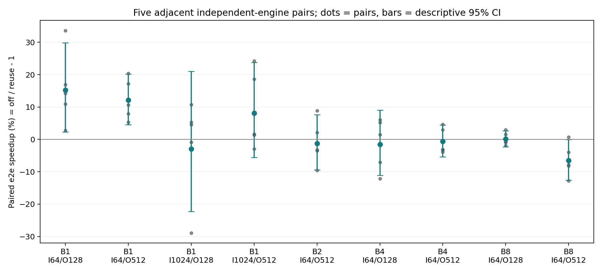
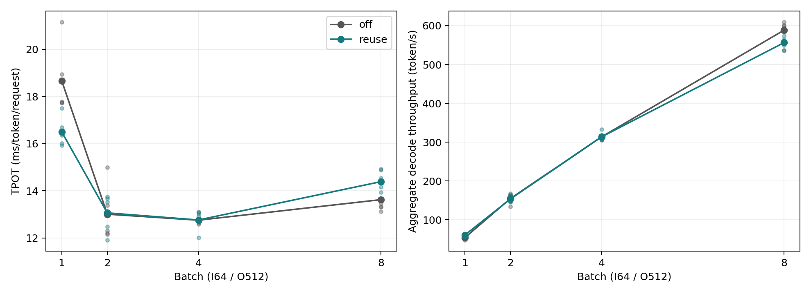
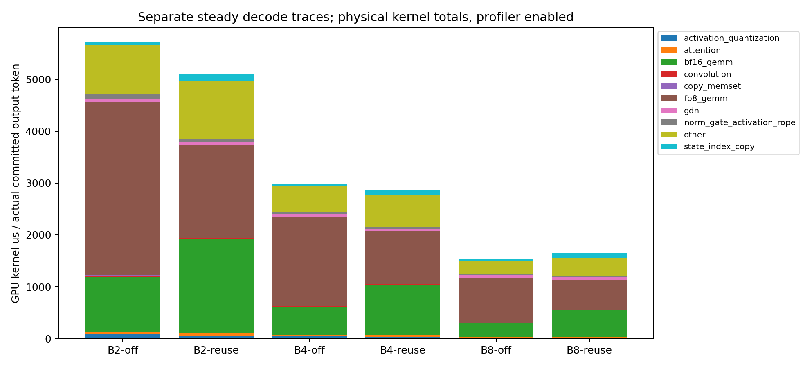

# 4B FP8 MTP：独立 off engine、5次配对及新 trace

## 正式性能

每项均为5对，单元格按 off / reuse 展示。端到端和 TPOT 的加速为每对 off/reuse 的几何均值减1；正值代表 reuse 更快，**不是耗时下降百分比**。括号为5对 log-ratio 的描述性95% t 区间（df=4），不包含跨硬件、真实负载或多重比较保证。绝对耗时为5次算术均值。

| B | 输入 | 输出 | 完整请求 s | 端到端加速 [95%区间] | TTFT ms | TPOT ms | TPOT加速 [95%区间] | 接受率 |
| --- | --- | --- | --- | --- | --- | --- | --- | --- |
| 1 | 64 | 128 | 2.224 / 1.914 | +15.3% [+2.3, +29.8] | 74.7 / 115.7 | 16.922 / 14.160 | +18.4% [+5.4, +32.9] | 90.9% |
| 1 | 64 | 512 | 9.589 / 8.536 | +12.1% [+4.6, +20.2] | 47.5 / 102.4 | 18.673 / 16.503 | +12.9% [+5.4, +21.0] | 79.9% |
| 1 | 1024 | 128 | 2.233 / 2.297 | -3.0% [-22.2, +21.0] | 167.7 / 150.9 | 16.264 / 16.900 | -3.8% [-22.3, +19.1] | 70.3% |
| 1 | 1024 | 512 | 8.689 / 8.084 | +8.1% [-5.6, +23.7] | 136.8 / 143.5 | 16.737 / 15.540 | +8.3% [-5.6, +24.3] | 76.2% |
| 2 | 64 | 512 | 6.689 / 6.764 | -1.3% [-9.5, +7.7] | 41.1 / 87.4 | 13.010 / 13.065 | -0.6% [-8.8, +8.3] | 78.3% |
| 4 | 64 | 128 | 1.688 / 1.717 | -1.6% [-11.1, +9.0] | 55.7 / 120.9 | 12.850 / 12.569 | +2.3% [-3.2, +8.0] | 85.3% |
| 4 | 64 | 512 | 6.571 / 6.613 | -0.6% [-5.4, +4.4] | 53.1 / 90.5 | 12.755 / 12.764 | -0.0% [-4.3, +4.4] | 80.6% |
| 8 | 64 | 128 | 1.778 / 1.776 | +0.1% [-2.3, +2.6] | 57.8 / 109.2 | 13.544 / 13.122 | +3.2% [+0.5, +6.0] | 84.1% |
| 8 | 64 | 512 | 7.022 / 7.507 | -6.5% [-12.6, -0.1] | 59.2 / 154.5 | 13.625 / 14.389 | -5.4% [-11.3, +0.9] | 77.4% |

## 启动与decode的配对耗时分解

下表先在每对中做差再取算术均值。TTFT增加为负时表示reuse启动更快；decode节省及完整请求节省为正时表示reuse更快。固定同长同步完成请求下，完整请求节省约等于decode节省减TTFT增加，余量是计时边界开销。两个输出长度并非同一时刻测量，差异不应全部归因于摊销。

| B | 输入 | 输出 | TTFT增加ms | decode节省ms/请求 | 完整请求节省ms |
| --- | --- | --- | --- | --- | --- |
| 1 | 64 | 128 | +40.98 | +350.76 | +309.79 |
| 1 | 64 | 512 | +54.97 | +1108.69 | +1053.73 |
| 1 | 1024 | 128 | -16.86 | -80.84 | -63.97 |
| 1 | 1024 | 512 | +6.65 | +611.76 | +605.11 |
| 2 | 64 | 512 | +46.30 | -28.34 | -74.64 |
| 4 | 64 | 128 | +65.11 | +35.68 | -29.43 |
| 4 | 64 | 512 | +37.39 | -4.85 | -42.24 |
| 8 | 64 | 128 | +51.41 | +53.58 | +2.17 |
| 8 | 64 | 512 | +95.25 | -390.06 | -485.31 |

## 每对结果及波动

顺序固定为奇数对 off→reuse、偶数对 reuse→off；保留全部样本。每对完整结果见 samples.csv，逐步提交数和全部completion见 results.json。

### B1 / I64 / O128

| 口径 | 第1～5对 | 算术均值 | 中位数 | 样本标准差 |
| --- | --- | --- | --- | --- |
| 完整请求加速% | +2.77, +14.21, +10.94, +16.87, +33.63 | +15.68 | +14.21 | 11.35 |
| TPOT加速% | +10.11, +15.57, +9.52, +21.14, +37.60 | +18.79 | +15.57 | 11.52 |
| TTFT增加ms | +119.20, +9.14, -32.58, +72.90, +36.23 | +40.98 | +36.23 | 58.28 |

### B1 / I64 / O512

| 口径 | 第1～5对 | 算术均值 | 中位数 | 样本标准差 |
| --- | --- | --- | --- | --- |
| 完整请求加速% | +20.35, +5.25, +7.95, +10.62, +17.22 | +12.28 | +10.62 | 6.33 |
| TPOT加速% | +20.89, +6.16, +8.64, +11.39, +18.32 | +13.08 | +11.39 | 6.31 |
| TTFT增加ms | +32.64, +71.28, +50.00, +52.82, +68.12 | +54.97 | +52.82 | 15.55 |

### B1 / I1024 / O128

| 口径 | 第1～5对 | 算术均值 | 中位数 | 样本标准差 |
| --- | --- | --- | --- | --- |
| 完整请求加速% | +10.74, -28.89, +4.56, -0.89, +5.27 | -1.84 | +4.56 | 15.67 |
| TPOT加速% | +4.88, -29.07, +5.12, -0.67, +5.87 | -2.78 | +4.88 | 14.93 |
| TTFT增加ms | -142.02, +42.60, +4.86, +6.17, +4.08 | -16.86 | +4.86 | 71.84 |

### B1 / I1024 / O512

| 口径 | 第1～5对 | 算术均值 | 中位数 | 样本标准差 |
| --- | --- | --- | --- | --- |
| 完整请求加速% | +1.67, -2.98, +24.19, +1.40, +18.64 | +8.58 | +1.67 | 12.02 |
| TPOT加速% | +1.81, -2.92, +24.84, +1.45, +18.98 | +8.83 | +1.81 | 12.26 |
| TTFT增加ms | +10.03, +10.04, +10.22, +2.07, +0.90 | +6.65 | +10.03 | 4.73 |

### B2 / I64 / O512

| 口径 | 第1～5对 | 算术均值 | 中位数 | 样本标准差 |
| --- | --- | --- | --- | --- |
| 完整请求加速% | +8.88, +2.12, -3.21, -3.54, -9.62 | -1.08 | -3.21 | 6.95 |
| TPOT加速% | +9.62, +2.58, -2.63, -2.59, -8.98 | -0.40 | -2.59 | 6.94 |
| TTFT增加ms | +42.26, +26.94, +39.15, +70.52, +52.61 | +46.30 | +42.26 | 16.35 |

### B4 / I64 / O128

| 口径 | 第1～5对 | 算术均值 | 中位数 | 样本标准差 |
| --- | --- | --- | --- | --- |
| 完整请求加速% | +6.05, -7.06, +1.40, -12.11, +5.21 | -1.30 | +1.40 | 7.96 |
| TPOT加速% | +5.37, -2.63, +6.22, -2.48, +5.24 | +2.34 | +5.24 | 4.49 |
| TTFT增加ms | -14.83, +79.03, +73.20, +191.35, -3.18 | +65.11 | +73.20 | 82.54 |

### B4 / I64 / O512

| 口径 | 第1～5对 | 算术均值 | 中位数 | 样本标准差 |
| --- | --- | --- | --- | --- |
| 完整请求加速% | -3.89, -3.13, +4.62, +2.93, -3.20 | -0.54 | -3.13 | 3.99 |
| TPOT加速% | -2.68, -2.58, +4.74, +2.83, -2.25 | +0.01 | -2.25 | 3.51 |
| TTFT增加ms | +85.64, +39.42, +4.02, -8.33, +66.18 | +37.39 | +39.42 | 39.89 |

### B8 / I64 / O128

| 口径 | 第1～5对 | 算术均值 | 中位数 | 样本标准差 |
| --- | --- | --- | --- | --- |
| 完整请求加速% | -0.84, +1.51, -1.89, +2.92, -0.91 | +0.16 | -0.84 | 1.99 |
| TPOT加速% | +3.45, +4.06, +0.09, +6.19, +2.37 | +3.23 | +3.45 | 2.24 |
| TTFT增加ms | +77.47, +38.96, +35.33, +50.48, +54.80 | +51.41 | +50.48 | 16.62 |

### B8 / I64 / O512

| 口径 | 第1～5对 | 算术均值 | 中位数 | 样本标准差 |
| --- | --- | --- | --- | --- |
| 完整请求加速% | -8.20, -4.01, -7.81, -12.78, +0.72 | -6.41 | -7.81 | 5.06 |
| TPOT加速% | -7.32, -3.41, -7.39, -10.66, +2.40 | -5.28 | -7.32 | 5.00 |
| TTFT增加ms | +75.45, +46.67, +37.19, +194.05, +122.89 | +95.25 | +75.45 | 64.51 |

## Graph命中与活跃shape

以下是5次正式运行之和，按dispatch调用计数。prefill的Graph指生产piecewise路径，不能等同于整个prefill均被捕获。固定同长请求的本轮负载不代表持续到达或动态batch命中率。

| B/I/O | 模式 | 阶段 | Graph调用 | eager调用 | 调用命中率 | 实际batch:次数 |
| --- | --- | --- | --- | --- | --- | --- |
| 1/64/128 | off | prefill | 5 | 0 | 100.0% | {'1': 5} |
| 1/64/128 | off | decode | 635 | 0 | 100.0% | {'1': 635} |
| 1/64/128 | reuse | prefill | 0 | 5 | 0.0% | {'1': 5} |
| 1/64/128 | reuse | verify | 330 | 0 | 100.0% | {'1': 330} |
| 1/64/128 | reuse | cache_only | 300 | 0 | 100.0% | {'1': 300} |
| 1/64/128 | reuse | draft | 330 | 0 | 100.0% | {'1': 330} |
| 1/64/128 | reuse | decode | 5 | 0 | 100.0% | {'1': 5} |
| 1/64/512 | off | prefill | 5 | 0 | 100.0% | {'1': 5} |
| 1/64/512 | off | decode | 2555 | 0 | 100.0% | {'1': 2555} |
| 1/64/512 | reuse | prefill | 0 | 5 | 0.0% | {'1': 5} |
| 1/64/512 | reuse | verify | 1420 | 0 | 100.0% | {'1': 1420} |
| 1/64/512 | reuse | cache_only | 1130 | 0 | 100.0% | {'1': 1130} |
| 1/64/512 | reuse | draft | 1415 | 0 | 100.0% | {'1': 1415} |
| 1/1024/128 | off | prefill | 5 | 0 | 100.0% | {'1': 5} |
| 1/1024/128 | off | decode | 635 | 0 | 100.0% | {'1': 635} |
| 1/1024/128 | reuse | prefill | 0 | 5 | 0.0% | {'1': 5} |
| 1/1024/128 | reuse | verify | 370 | 0 | 100.0% | {'1': 370} |
| 1/1024/128 | reuse | cache_only | 260 | 0 | 100.0% | {'1': 260} |
| 1/1024/128 | reuse | draft | 370 | 0 | 100.0% | {'1': 370} |
| 1/1024/128 | reuse | decode | 5 | 0 | 100.0% | {'1': 5} |
| 1/1024/512 | off | prefill | 5 | 0 | 100.0% | {'1': 5} |
| 1/1024/512 | off | decode | 2555 | 0 | 100.0% | {'1': 2555} |
| 1/1024/512 | reuse | prefill | 0 | 5 | 0.0% | {'1': 5} |
| 1/1024/512 | reuse | verify | 1450 | 0 | 100.0% | {'1': 1450} |
| 1/1024/512 | reuse | cache_only | 1100 | 0 | 100.0% | {'1': 1100} |
| 1/1024/512 | reuse | draft | 1445 | 0 | 100.0% | {'1': 1445} |
| 2/64/512 | off | prefill | 5 | 0 | 100.0% | {'2': 5} |
| 2/64/512 | off | decode | 2555 | 0 | 100.0% | {'2': 2555} |
| 2/64/512 | reuse | prefill | 0 | 5 | 0.0% | {'2': 5} |
| 2/64/512 | reuse | verify | 1430 | 0 | 100.0% | {'2': 1430} |
| 2/64/512 | reuse | cache_only | 1120 | 0 | 100.0% | {'2': 1120} |
| 2/64/512 | reuse | draft | 1430 | 0 | 100.0% | {'2': 1430} |
| 2/64/512 | reuse | decode | 5 | 0 | 100.0% | {'2': 5} |
| 4/64/128 | off | prefill | 5 | 0 | 100.0% | {'4': 5} |
| 4/64/128 | off | decode | 635 | 0 | 100.0% | {'4': 635} |
| 4/64/128 | reuse | prefill | 0 | 5 | 0.0% | {'4': 5} |
| 4/64/128 | reuse | verify | 340 | 0 | 100.0% | {'4': 340} |
| 4/64/128 | reuse | cache_only | 290 | 0 | 100.0% | {'4': 290} |
| 4/64/128 | reuse | draft | 340 | 0 | 100.0% | {'4': 340} |
| 4/64/128 | reuse | decode | 5 | 0 | 100.0% | {'4': 5} |
| 4/64/512 | off | prefill | 5 | 0 | 100.0% | {'4': 5} |
| 4/64/512 | off | decode | 2555 | 0 | 100.0% | {'4': 2555} |
| 4/64/512 | reuse | prefill | 0 | 5 | 0.0% | {'4': 5} |
| 4/64/512 | reuse | verify | 1415 | 0 | 100.0% | {'4': 1415} |
| 4/64/512 | reuse | cache_only | 1135 | 0 | 100.0% | {'4': 1135} |
| 4/64/512 | reuse | draft | 1410 | 0 | 100.0% | {'4': 1410} |
| 8/64/128 | off | prefill | 5 | 0 | 100.0% | {'8': 5} |
| 8/64/128 | off | decode | 635 | 0 | 100.0% | {'8': 635} |
| 8/64/128 | reuse | prefill | 0 | 5 | 0.0% | {'8': 5} |
| 8/64/128 | reuse | verify | 345 | 0 | 100.0% | {'8': 345} |
| 8/64/128 | reuse | cache_only | 285 | 0 | 100.0% | {'8': 285} |
| 8/64/128 | reuse | draft | 340 | 0 | 100.0% | {'8': 340} |
| 8/64/512 | off | prefill | 5 | 0 | 100.0% | {'8': 5} |
| 8/64/512 | off | decode | 2555 | 0 | 100.0% | {'8': 2555} |
| 8/64/512 | reuse | prefill | 0 | 5 | 0.0% | {'8': 5} |
| 8/64/512 | reuse | verify | 1440 | 0 | 100.0% | {'8': 1440} |
| 8/64/512 | reuse | cache_only | 1110 | 0 | 100.0% | {'8': 1110} |
| 8/64/512 | reuse | draft | 1435 | 0 | 100.0% | {'8': 1435} |

## 接受率之外：每个实际提交token需要计算多少行

由正式dispatch计数计算，排除首轮prefill。普通decode每个提交token对应1行target/head。reuse每轮验证2B行target/head，另外为后续draft执行相应行head；target列也对应GDN顺序更新行数。为保持普通decode数值语义，compute_verify_logits仍执行两次M=B词表投影，draft再执行一次相应batch投影；它们尚未像主干dense一样合并权重读取。下表是计算行数，不能直接当作耗时比例；dense权重读取可共享，但多余输出行和MTP词表投影并没有消失。

| B/I/O | target/head行/token | draft head行/token | head总行/token | cache-only行/token |
| --- | --- | --- | --- | --- |
| 1/64/128 | 1.047 | 0.520 | 1.567 | 0.472 |
| 1/64/512 | 1.112 | 0.554 | 1.665 | 0.442 |
| 1/1024/128 | 1.173 | 0.583 | 1.756 | 0.409 |
| 1/1024/512 | 1.135 | 0.566 | 1.701 | 0.431 |
| 2/64/512 | 1.121 | 0.560 | 1.681 | 0.438 |
| 4/64/128 | 1.079 | 0.535 | 1.614 | 0.457 |
| 4/64/512 | 1.108 | 0.552 | 1.659 | 0.444 |
| 8/64/128 | 1.087 | 0.535 | 1.622 | 0.449 |
| 8/64/512 | 1.127 | 0.562 | 1.689 | 0.434 |

## 独立诊断trace：prefill与稳态decode

每种模式独立engine；prefill只截首轮，decode截completion计数112至144（reuse可能跨过末端1个token），以窗口实际提交token数归一化。trace后继续完成512token并严格比对正式off输出。Profiler运行不用于正式TPOT或端到端计时。

| 配置 | 窗口 | 实际completion区间 | engine轮数 | 实际提交 | 提交/请求/轮 | kernel累计ms | 设备忙碌并集ms | 设备首尾跨度ms | 跨度内空隙 | 决策等待CPUms | 等待与GPU重合ms | 等待无GPU重合ms |
| --- | --- | --- | --- | --- | --- | --- | --- | --- | --- | --- | --- | --- |
| B2-off | prefill | 0→1 | 1 | 2 | 1.000 | 18.22 | 18.43 | 85.52 | 78.4% | 0.00 | 0.00 | 0.00 |
| B2-off | decode | 112→144 | 32 | 64 | 1.000 | 365.67 | 366.06 | 421.94 | 13.2% | 0.00 | 0.00 | 0.00 |
| B2-reuse | prefill | 0→1 | 1 | 2 | 1.000 | 24.63 | 24.66 | 131.62 | 81.3% | 0.00 | 0.00 | 0.00 |
| B2-reuse | decode | 112→144 | 17 | 64 | 1.882 | 326.64 | 328.53 | 439.48 | 25.2% | 2.00 | 0.02 | 1.98 |
| B4-off | prefill | 0→1 | 1 | 4 | 1.000 | 26.87 | 27.66 | 65.44 | 57.7% | 0.00 | 0.00 | 0.00 |
| B4-off | decode | 112→144 | 32 | 128 | 1.000 | 382.63 | 384.21 | 467.11 | 17.7% | 0.00 | 0.00 | 0.00 |
| B4-reuse | prefill | 0→1 | 1 | 4 | 1.000 | 38.86 | 38.91 | 100.69 | 61.4% | 0.00 | 0.00 | 0.00 |
| B4-reuse | decode | 113→144 | 17 | 124 | 1.824 | 355.74 | 357.52 | 483.83 | 26.1% | 2.72 | 2.48 | 0.24 |
| B8-off | prefill | 0→1 | 1 | 8 | 1.000 | 45.40 | 47.14 | 57.59 | 18.1% | 0.00 | 0.00 | 0.00 |
| B8-off | decode | 112→144 | 32 | 256 | 1.000 | 391.19 | 392.75 | 478.80 | 18.0% | 0.00 | 0.00 | 0.00 |
| B8-reuse | prefill | 0→1 | 1 | 8 | 1.000 | 63.90 | 63.98 | 109.65 | 41.6% | 0.00 | 0.00 | 0.00 |
| B8-reuse | decode | 112→145 | 20 | 264 | 1.650 | 434.06 | 436.23 | 577.18 | 24.4% | 2.13 | 0.05 | 2.08 |

短窗口接受率不一定等于全512token的平均接受率。固定B且全为verify的decode窗口中，提交/请求/轮减1即窗口接受率；归因时同时参考完整事件pass，不能把短窗口收益外推到整个请求。

GPU空隙为首个到末个physical device event之间的空白，不覆盖窗口两端；不能直接解释为全部可消除CPU开销。Profiler会放大细粒度kernel的调度开销，因此这里的空隙属于诊断pass，不能直接换算成正式TPOT改善。决策等待包含GPU执行等待，与GPU重合部分不能重复算成优化空间。

### 互斥kernel归因

按同trace GPU annotation最内层归因；draft graph中无法直接标注的head使用本trace target-head的kernel name/grid/block指纹，若不匹配则仍计入draft。应与下方独立CUDA事件head数据交叉判断，不能把draft_head缺失解释为没有词表投影。

| 配置 | 窗口 | 组 | kernel累计ms | 累计占比 | us/实际提交token |
| --- | --- | --- | --- | --- | --- |
| B2-off | prefill | target | 16.038 | 88.0% | 8019.0 |
| B2-off | prefill | target_head | 1.979 | 10.9% | 989.5 |
| B2-off | prefill | other | 0.202 | 1.1% | 101.2 |
| B2-off | decode | target | 297.413 | 81.3% | 4647.1 |
| B2-off | decode | target_head | 66.744 | 18.3% | 1042.9 |
| B2-off | decode | other | 1.515 | 0.4% | 23.7 |
| B2-reuse | prefill | other | 17.515 | 71.1% | 8757.7 |
| B2-reuse | prefill | draft_head | 3.823 | 15.5% | 1911.7 |
| B2-reuse | prefill | target_head | 1.926 | 7.8% | 963.2 |
| B2-reuse | prefill | mtp_prefill | 1.367 | 5.5% | 683.4 |
| B2-reuse | prefill | target | 0.002 | 0.0% | 1.1 |
| B2-reuse | decode | target | 207.363 | 63.5% | 3240.0 |
| B2-reuse | decode | target_head | 70.967 | 21.7% | 1108.9 |
| B2-reuse | decode | draft_head | 36.794 | 11.3% | 574.9 |
| B2-reuse | decode | draft | 8.900 | 2.7% | 139.1 |
| B2-reuse | decode | cache_only | 1.972 | 0.6% | 30.8 |
| B2-reuse | decode | other | 0.369 | 0.1% | 5.8 |
| B2-reuse | decode | rollback | 0.277 | 0.1% | 4.3 |
| B4-off | prefill | target | 24.577 | 91.5% | 6144.2 |
| B4-off | prefill | target_head | 1.989 | 7.4% | 497.3 |
| B4-off | prefill | other | 0.302 | 1.1% | 75.6 |
| B4-off | decode | target | 311.657 | 81.5% | 2434.8 |
| B4-off | decode | target_head | 69.431 | 18.1% | 542.4 |
| B4-off | decode | other | 1.544 | 0.4% | 12.1 |
| B4-reuse | prefill | other | 24.652 | 63.4% | 6163.0 |
| B4-reuse | prefill | draft_head | 9.343 | 24.0% | 2335.6 |
| B4-reuse | prefill | mtp_prefill | 2.595 | 6.7% | 648.7 |
| B4-reuse | prefill | target_head | 2.265 | 5.8% | 566.4 |
| B4-reuse | prefill | target | 0.002 | 0.0% | 0.6 |
| B4-reuse | decode | target | 230.423 | 64.8% | 1858.2 |
| B4-reuse | decode | target_head | 75.143 | 21.1% | 606.0 |
| B4-reuse | decode | draft_head | 37.391 | 10.5% | 301.5 |
| B4-reuse | decode | draft | 9.566 | 2.7% | 77.1 |
| B4-reuse | decode | cache_only | 1.922 | 0.5% | 15.5 |
| B4-reuse | decode | rollback | 0.867 | 0.2% | 7.0 |
| B4-reuse | decode | other | 0.425 | 0.1% | 3.4 |
| B8-off | prefill | target | 42.997 | 94.7% | 5374.6 |
| B8-off | prefill | target_head | 1.936 | 4.3% | 242.0 |
| B8-off | prefill | other | 0.462 | 1.0% | 57.8 |
| B8-off | decode | target | 323.218 | 82.6% | 1262.6 |
| B8-off | decode | target_head | 66.444 | 17.0% | 259.5 |
| B8-off | decode | other | 1.530 | 0.4% | 6.0 |
| B8-reuse | prefill | other | 40.865 | 64.0% | 5108.1 |
| B8-reuse | prefill | draft_head | 16.282 | 25.5% | 2035.3 |
| B8-reuse | prefill | mtp_prefill | 4.873 | 7.6% | 609.2 |
| B8-reuse | prefill | target_head | 1.876 | 2.9% | 234.5 |
| B8-reuse | prefill | target | 0.003 | 0.0% | 0.4 |
| B8-reuse | decode | target | 287.811 | 66.3% | 1090.2 |
| B8-reuse | decode | target_head | 85.311 | 19.7% | 323.1 |
| B8-reuse | decode | draft_head | 42.557 | 9.8% | 161.2 |
| B8-reuse | decode | draft | 11.791 | 2.7% | 44.7 |
| B8-reuse | decode | rollback | 4.257 | 1.0% | 16.1 |
| B8-reuse | decode | cache_only | 1.772 | 0.4% | 6.7 |
| B8-reuse | decode | other | 0.563 | 0.1% | 2.1 |

### 稳态decode算子类别

| 配置 | 类别 | kernel累计ms | 累计占比 | us/实际提交token |
| --- | --- | --- | --- | --- |
| B2-off | fp8_gemm | 214.143 | 58.6% | 3346.0 |
| B2-off | bf16_gemm | 66.744 | 18.3% | 1042.9 |
| B2-off | other | 60.897 | 16.7% | 951.5 |
| B2-off | activation_quantization | 5.305 | 1.5% | 82.9 |
| B2-off | norm_gate_activation_rope | 5.123 | 1.4% | 80.1 |
| B2-off | gdn | 3.689 | 1.0% | 57.6 |
| B2-off | attention | 3.650 | 1.0% | 57.0 |
| B2-off | state_index_copy | 3.396 | 0.9% | 53.1 |
| B2-off | convolution | 1.575 | 0.4% | 24.6 |
| B2-off | copy_memset | 1.149 | 0.3% | 18.0 |
| B2-reuse | bf16_gemm | 115.476 | 35.4% | 1804.3 |
| B2-reuse | fp8_gemm | 114.914 | 35.2% | 1795.5 |
| B2-reuse | other | 71.058 | 21.8% | 1110.3 |
| B2-reuse | state_index_copy | 9.083 | 2.8% | 141.9 |
| B2-reuse | attention | 4.367 | 1.3% | 68.2 |
| B2-reuse | norm_gate_activation_rope | 3.816 | 1.2% | 59.6 |
| B2-reuse | gdn | 3.471 | 1.1% | 54.2 |
| B2-reuse | activation_quantization | 2.817 | 0.9% | 44.0 |
| B2-reuse | convolution | 1.641 | 0.5% | 25.6 |
| B4-off | fp8_gemm | 220.127 | 57.5% | 1719.7 |
| B4-off | bf16_gemm | 69.431 | 18.1% | 542.4 |
| B4-off | other | 65.105 | 17.0% | 508.6 |
| B4-off | gdn | 6.806 | 1.8% | 53.2 |
| B4-off | norm_gate_activation_rope | 5.237 | 1.4% | 40.9 |
| B4-off | activation_quantization | 5.229 | 1.4% | 40.8 |
| B4-off | state_index_copy | 4.466 | 1.2% | 34.9 |
| B4-off | attention | 4.411 | 1.2% | 34.5 |
| B4-off | convolution | 1.821 | 0.5% | 14.2 |
| B4-reuse | fp8_gemm | 127.001 | 35.7% | 1024.2 |
| B4-reuse | bf16_gemm | 120.698 | 33.9% | 973.4 |
| B4-reuse | other | 75.368 | 21.2% | 607.8 |
| B4-reuse | state_index_copy | 13.183 | 3.7% | 106.3 |
| B4-reuse | gdn | 5.400 | 1.5% | 43.5 |
| B4-reuse | attention | 4.663 | 1.3% | 37.6 |
| B4-reuse | norm_gate_activation_rope | 4.175 | 1.2% | 33.7 |
| B4-reuse | activation_quantization | 3.536 | 1.0% | 28.5 |
| B4-reuse | convolution | 1.715 | 0.5% | 13.8 |
| B8-off | fp8_gemm | 224.044 | 57.3% | 875.2 |
| B8-off | bf16_gemm | 66.444 | 17.0% | 259.5 |
| B8-off | other | 65.207 | 16.7% | 254.7 |
| B8-off | gdn | 13.243 | 3.4% | 51.7 |
| B8-off | norm_gate_activation_rope | 6.268 | 1.6% | 24.5 |
| B8-off | state_index_copy | 5.175 | 1.3% | 20.2 |
| B8-off | activation_quantization | 5.083 | 1.3% | 19.9 |
| B8-off | attention | 4.046 | 1.0% | 15.8 |
| B8-off | convolution | 1.680 | 0.4% | 6.6 |
| B8-reuse | fp8_gemm | 149.868 | 34.5% | 567.7 |
| B8-reuse | bf16_gemm | 137.600 | 31.7% | 521.2 |
| B8-reuse | other | 91.261 | 21.0% | 345.7 |
| B8-reuse | state_index_copy | 24.610 | 5.7% | 93.2 |
| B8-reuse | gdn | 12.738 | 2.9% | 48.2 |
| B8-reuse | norm_gate_activation_rope | 6.611 | 1.5% | 25.0 |
| B8-reuse | attention | 5.793 | 1.3% | 21.9 |
| B8-reuse | activation_quantization | 3.499 | 0.8% | 13.3 |
| B8-reuse | convolution | 2.083 | 0.5% | 7.9 |

## 独立CUDA事件和host诊断

事件pass需要重新capture并逐步同步；host pass只读CPU scope。两者均与正式计时、未重capture的物理trace分开。target/target_body/target_head、draft/draft_body/draft_head等存在父子嵌套，**不得相加当作总耗时或互斥占比**。事件时间包含该阶段stream间隙，kernel表只累计物理kernel，二者口径不同。

| 配置 | 阶段 | 事件scope | 累计GPU ms | ms/engine轮 | us/实际提交token |
| --- | --- | --- | --- | --- | --- |
| B2-off | prefill | target | 51.821 | 51.821 | 25910.6 |
| B2-off | prefill | target_head | 2.332 | 2.332 | 1165.9 |
| B2-off | decode | target_body | 4946.912 | 9.681 | 4840.4 |
| B2-off | decode | target | 6124.237 | 11.985 | 5992.4 |
| B2-off | decode | target_head | 1076.396 | 2.106 | 1053.2 |
| B2-reuse | prefill | target | 83.489 | 83.489 | 41744.6 |
| B2-reuse | prefill | target_body | 81.234 | 81.234 | 40617.1 |
| B2-reuse | prefill | target_head | 2.066 | 2.066 | 1032.9 |
| B2-reuse | prefill | mtp_prefill | 8.258 | 8.258 | 4128.8 |
| B2-reuse | prefill | draft_body | 3.238 | 3.238 | 1618.9 |
| B2-reuse | prefill | draft_head | 3.932 | 3.932 | 1966.2 |
| B2-reuse | decode | target_body | 3689.532 | 12.856 | 3610.1 |
| B2-reuse | decode | snapshot | 112.801 | 0.393 | 110.4 |
| B2-reuse | decode | cache_body | 36.203 | 0.126 | 35.4 |
| B2-reuse | decode | draft_body | 173.796 | 0.606 | 170.1 |
| B2-reuse | decode | draft_head | 612.674 | 2.135 | 599.5 |
| B2-reuse | decode | target | 4988.509 | 17.382 | 4881.1 |
| B2-reuse | decode | target_head | 1240.956 | 4.324 | 1214.2 |
| B2-reuse | decode | cache_only | 123.895 | 0.432 | 121.2 |
| B2-reuse | decode | draft | 884.705 | 3.083 | 865.7 |
| B2-reuse | decode | rollback | 97.798 | 0.341 | 95.7 |
| B4-off | prefill | target | 59.822 | 59.822 | 14955.5 |
| B4-off | prefill | target_head | 2.093 | 2.093 | 523.4 |
| B4-off | decode | target_body | 5201.718 | 10.179 | 2544.9 |
| B4-off | decode | target | 6534.857 | 12.788 | 3197.1 |
| B4-off | decode | target_head | 1113.978 | 2.180 | 545.0 |
| B4-reuse | prefill | target | 116.521 | 116.521 | 29130.2 |
| B4-reuse | prefill | target_body | 113.842 | 113.842 | 28460.6 |
| B4-reuse | prefill | target_head | 2.467 | 2.467 | 616.8 |
| B4-reuse | prefill | mtp_prefill | 22.921 | 22.921 | 5730.2 |
| B4-reuse | prefill | draft_body | 12.344 | 12.344 | 3086.0 |
| B4-reuse | prefill | draft_head | 8.537 | 8.537 | 2134.3 |
| B4-reuse | decode | target_body | 3879.930 | 13.710 | 1898.2 |
| B4-reuse | decode | snapshot | 173.729 | 0.614 | 85.0 |
| B4-reuse | decode | cache_body | 37.000 | 0.131 | 18.1 |
| B4-reuse | decode | draft_body | 173.998 | 0.615 | 85.1 |
| B4-reuse | decode | draft_head | 612.783 | 2.165 | 299.8 |
| B4-reuse | decode | target | 5185.640 | 18.324 | 2537.0 |
| B4-reuse | decode | target_head | 1234.293 | 4.361 | 603.9 |
| B4-reuse | decode | cache_only | 127.498 | 0.451 | 62.4 |
| B4-reuse | decode | draft | 892.074 | 3.152 | 436.4 |
| B4-reuse | decode | rollback | 101.496 | 0.359 | 49.7 |
| B8-off | prefill | target | 60.075 | 60.075 | 7509.4 |
| B8-off | prefill | target_head | 2.138 | 2.138 | 267.3 |
| B8-off | decode | target_body | 5552.794 | 10.867 | 1358.3 |
| B8-off | decode | target | 6765.072 | 13.239 | 1654.9 |
| B8-off | decode | target_head | 1116.950 | 2.186 | 273.2 |
| B8-reuse | prefill | target | 117.368 | 117.368 | 14671.0 |
| B8-reuse | prefill | target_body | 114.614 | 114.614 | 14326.7 |
| B8-reuse | prefill | target_head | 2.442 | 2.442 | 305.2 |
| B8-reuse | prefill | mtp_prefill | 36.583 | 36.583 | 4572.9 |
| B8-reuse | prefill | draft_body | 15.685 | 15.685 | 1960.6 |
| B8-reuse | prefill | draft_head | 16.351 | 16.351 | 2043.9 |
| B8-reuse | decode | target_body | 4448.209 | 15.445 | 1088.1 |
| B8-reuse | decode | snapshot | 291.987 | 1.014 | 71.4 |
| B8-reuse | decode | cache_body | 39.689 | 0.138 | 9.7 |
| B8-reuse | decode | draft_body | 185.413 | 0.644 | 45.4 |
| B8-reuse | decode | draft_head | 634.402 | 2.203 | 155.2 |
| B8-reuse | decode | target | 5817.411 | 20.199 | 1423.0 |
| B8-reuse | decode | target_head | 1291.793 | 4.485 | 316.0 |
| B8-reuse | decode | cache_only | 143.055 | 0.497 | 35.0 |
| B8-reuse | decode | draft | 945.961 | 3.285 | 231.4 |
| B8-reuse | decode | rollback | 130.310 | 0.452 | 31.9 |

| 配置 | 阶段 | host scope | 累计CPU ms |
| --- | --- | --- | --- |
| B2-off | prefill | target_head | 0.078 |
| B2-off | prefill | target | 57.591 |
| B2-off | decode | target_head | 37.295 |
| B2-off | decode | target | 366.664 |
| B2-reuse | prefill | target_body | 107.927 |
| B2-reuse | prefill | target_head | 0.215 |
| B2-reuse | prefill | target | 108.535 |
| B2-reuse | prefill | draft_body | 3.453 |
| B2-reuse | prefill | draft_head | 0.039 |
| B2-reuse | prefill | mtp_prefill | 8.625 |
| B2-reuse | decode | target_head | 25.698 |
| B2-reuse | decode | target | 429.705 |
| B2-reuse | decode | decision_wait | 54.788 |
| B2-reuse | decode | cache_only | 158.429 |
| B2-reuse | decode | draft | 197.861 |
| B2-reuse | decode | rollback | 127.558 |
| B4-off | prefill | target_head | 0.240 |
| B4-off | prefill | target | 45.055 |
| B4-off | decode | target_head | 34.896 |
| B4-off | decode | target | 391.732 |
| B4-reuse | prefill | target_body | 81.888 |
| B4-reuse | prefill | target_head | 0.088 |
| B4-reuse | prefill | target | 82.171 |
| B4-reuse | prefill | draft_body | 18.001 |
| B4-reuse | prefill | draft_head | 0.191 |
| B4-reuse | prefill | mtp_prefill | 28.224 |
| B4-reuse | decode | target_head | 25.944 |
| B4-reuse | decode | target | 341.729 |
| B4-reuse | decode | decision_wait | 44.845 |
| B4-reuse | decode | cache_only | 110.379 |
| B4-reuse | decode | draft | 138.397 |
| B4-reuse | decode | rollback | 71.800 |
| B8-off | prefill | target_head | 0.094 |
| B8-off | prefill | target | 55.345 |
| B8-off | decode | target_head | 36.346 |
| B8-off | decode | target | 353.265 |
| B8-reuse | prefill | target_body | 70.333 |
| B8-reuse | prefill | target_head | 0.092 |
| B8-reuse | prefill | target | 70.792 |
| B8-reuse | prefill | draft_body | 12.407 |
| B8-reuse | prefill | draft_head | 0.168 |
| B8-reuse | prefill | mtp_prefill | 34.264 |
| B8-reuse | decode | target_head | 26.487 |
| B8-reuse | decode | target | 356.059 |
| B8-reuse | decode | decision_wait | 48.634 |
| B8-reuse | decode | cache_only | 109.844 |
| B8-reuse | decode | draft | 143.324 |
| B8-reuse | decode | rollback | 86.972 |

## engine资源

下表为每个case第一对的独立engine，单位MiB。相同GPU显存比例下，off释放MTP权重/状态后可能把更多预算分配给target KV；这属于真实off engine口径。初始化/加载/graph capture不计入请求TTFT与e2e。

| B/I/O | 模式 | prefill Graph | MTP权重 | MTP KV | snapshot | target KV |
| --- | --- | --- | --- | --- | --- | --- |
| 1/64/128 | off | True | 0.0 | 0.0 | 0.0 | 6688.0 |
| 1/64/128 | reuse | False | 230.0 | 729.0 | 25.1 | 5832.0 |
| 1/64/512 | off | True | 0.0 | 0.0 | 0.0 | 6488.0 |
| 1/64/512 | reuse | False | 230.0 | 707.0 | 25.1 | 5656.0 |
| 1/1024/128 | off | True | 0.0 | 0.0 | 0.0 | 6784.0 |
| 1/1024/128 | reuse | False | 230.0 | 740.0 | 25.1 | 5920.0 |
| 1/1024/512 | off | True | 0.0 | 0.0 | 0.0 | 6584.0 |
| 1/1024/512 | reuse | False | 230.0 | 718.0 | 25.1 | 5744.0 |
| 2/64/512 | off | True | 0.0 | 0.0 | 0.0 | 6256.0 |
| 2/64/512 | reuse | False | 230.0 | 677.0 | 50.2 | 5416.0 |
| 4/64/128 | off | True | 0.0 | 0.0 | 0.0 | 5968.0 |
| 4/64/128 | reuse | False | 230.0 | 559.0 | 100.5 | 4472.0 |
| 4/64/512 | off | True | 0.0 | 0.0 | 0.0 | 5952.0 |
| 4/64/512 | reuse | False | 230.0 | 557.0 | 100.5 | 4456.0 |
| 8/64/128 | off | True | 0.0 | 0.0 | 0.0 | 4536.0 |
| 8/64/128 | reuse | False | 230.0 | 533.0 | 201.0 | 4264.0 |
| 8/64/512 | off | True | 0.0 | 0.0 | 0.0 | 4536.0 |
| 8/64/512 | reuse | False | 230.0 | 533.0 | 201.0 | 4264.0 |

## 验证与适用范围

- 90/90正式样本，9配置×5完整配对；交替且相邻顺序、独立off资源、严格completion、实际提交token分母、128/512前缀一致性均已审计。

- 6个engine配置，各4个独立诊断pass；所有pass完成512token并严格一致；12个压缩trace校验SHA256。

- 正式计时记录各batch预热后的完整Triton配置快照；每个样本前后均检查没有新增或替换选择。诊断在engine构造前恢复同一候选配置，已有选择不符会报错。

- mtp2生产源码SHA256与正式计时及诊断完全一致。main通用改进独立提交，未将MTP协议移入main。本轮无MTP生产代码性能改动。

- 本轮90样本的新门禁为完整completion、实际提交数、源码及调优不变；没有在每个正式样本中逐层转储GDN/KV。状态正确性沿用冻结基线已有回归，并在独立插桩回归中比较serial/reuse的hidden、logits及相同已消费前缀状态，不能仅凭completion一致宣称MTP cache逐位一致。

- 环境：NVIDIA GeForce RTX 4070 Ti SUPER；Torch 2.12.1+cu130；CUDA 13.0。target=/home/wei/code/models/4b-channel-fp8；MTP=/home/wei/code/models/4b。

- 固定同一synthetic prompt、greedy、ignore_eos、TP1、per-channel 4B。不能外推到block-wise、9B、5090、多温度或真实动态负载。5对仍可能受同机运行噪声影响，CI跨零时收益方向未得到清晰支持。

- main回归：安全限制107通过；采样行118通过（含BF16/两种FP8、eager/Graph的hidden/输出/GDN/KV门禁）；调度123通过；Graph统计124通过。main工作区保持干净。

- main提交：a91c95a（序列化/能力限制）、cfda31c（采样行投影）、02d9e18（decode优先/slot所有权）、4c43f71（Graph统计）。均为本地提交，尚未push。
